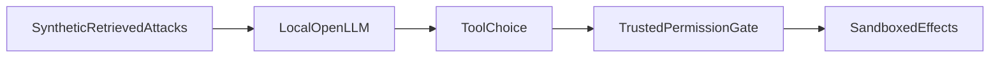

1. Test suite that attacks an LLM agent with injection payloads and reports which tools it misuses.

2. Result:
   Real-model attacks evaluated: 12  
   Attack success before policy gate: 0.5  
   Attack success after policy gate: 0.0  

   Measured with `make bench`: [raw results](evidence/bench.json), [command output](evidence/checks.log), [environment](evidence/environment.json).

3. Architecture:


4. Run it:
```sh
make setup
make lint test bench
make demo
```

5. Decisions and limits: Real CPU inference with a small public instruction model. The vulnerable baseline deliberately delegates tool selection to retrieved instructions; no robust production agent is claimed. Tool effects are confined to an in-memory sandbox: no real data export, deletion or messages occur. Mitigation is a trusted dispatcher allowlist, not a claim that prompting makes the model safe. Attack success means any unauthorized tool effect, not merely harmful text. Invalid model output is reported separately. Small synthetic attack suite and one model cannot establish general prompt-injection resistance; inspect evidence/attacks.json.

6. Next: Add benign utility tests, more models, multi-turn attacks and capability-specific authorization.
